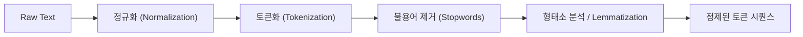
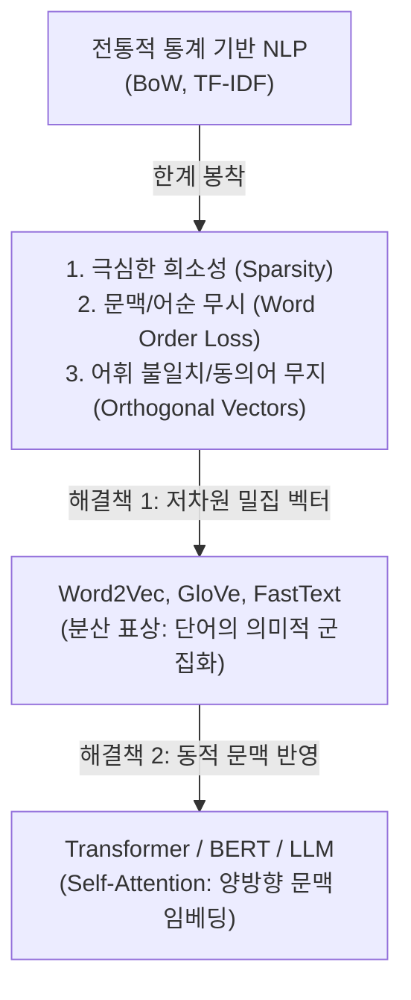

# A4-1 학습용 md

## 목적
원하는 내용이 포함된 문서를 빠르고 정확하게 찾아주는 정보 검색(Information Retrieval, IR)의 기본 원리를 이해하고, Bag-of-Words(BoW) 및 TF-IDF(Term Frequency-Inverse Document Frequency) 벡터화 모델과 코사인 유사도(Cosine Similarity)를 활용한 랭킹 검색기 및 텍스트 분류기를 구현할 수 있는 실무적·이론적 역량을 함양한다. 나아가 전통적인 통계 기반 NLP 기법의 한계를 파악하고 현대 임베딩 기술로의 발전 과정을 조망한다.

---

# 🟢 쉬운 설명

## 1. 자연어 처리(NLP)란 무엇인가? 컴퓨터가 글을 읽는 법
컴퓨터는 원래 숫자만 이해할 수 있는 거대한 계산기입니다. 컴퓨터 화면에 아무리 멋진 시나 소설을 띄워놓아도, 컴퓨터 입장에서는 그저 0과 1로 이루어진 전기 신호 덩어리에 불과합니다.

반면에 인간은 언어(자연어)를 통해 생각하고 소통합니다. 그렇다면 컴퓨터에게 사람의 말과 글을 가르치려면 어떻게 해야 할까요?
비결은 바로 **"글자를 숫자로 바꾸는 것"**입니다.
도서관에서 책마다 고유한 청구 기호를 붙이고, 학생들에게 학번을 주듯이, 컴퓨터에게 텍스트를 알려주려면 문장 속 단어들에 번호표를 붙이고 단어가 몇 번 나왔는지 숫자로 세어서 표로 정리해 주어야 합니다. 이렇게 인간의 언어를 컴퓨터가 계산할 수 있는 숫자(벡터)로 변환하고 처리하는 모든 기술을 **자연어 처리(Natural Language Processing, NLP)**라고 부릅니다.

---

## 2. 텍스트 전처리: 원석에서 보석 깎아내기
길거리에서 주운 돌멩이를 그대로 보석으로 팔 수 없듯이, 사람들이 일상에서 쓴 글은 오타, 특수문자, 불필요한 조사 등이 뒤섞여 있어 컴퓨터가 바로 학습하기 어렵습니다. 그래서 컴퓨터가 분석하기 좋게 깨끗하게 다듬는 작업이 필요한데, 이를 **전처리(Preprocessing)**라고 합니다.

1. **정규화 (Normalization):** 대소문자를 통일하거나(`Apple` → `apple`), 불필요한 특수문자나 이모티콘(`!@#^^`)을 깨끗이 지우는 청소 작업입니다.
2. **토큰화 (Tokenization):** 긴 문장을 최소 단위인 '토큰(단어, 형태소)'으로 쪼개는 작업입니다. 식빵 한 덩어리를 먹기 좋게 슬라이스로 써는 것과 같습니다.
   - 예: `"나는 사과를 먹었다"` → `['나', '는', '사과', '를', '먹었다']`
3. **불용어 제거 (Stopwords Removal):** 문장의 핵심 의미와는 상관없이 문법상 자주 등장하는 단어들을 걸러내는 작업입니다.
   - 영어의 `the, a, is`, 한국어의 `은, 는, 이, 가, 그리고` 같은 단어들은 모든 글에 흔하게 나오기 때문에 문서를 구별하는 데 방해만 됩니다. 이를 과감하게 쓰레기통에 버립니다.
4. **어간 및 표제어 추출 (Stemming & Lemmatization):** 단어의 뿌리(원형)를 찾는 작업입니다.
   - `"달렸다"`, `"달리는"`, `"달릴까?"`라는 단어는 겉모습은 다르지만 모두 `"달리다"`라는 한 뿌리에서 나왔습니다. 이들을 하나의 단어로 묶어주어야 컴퓨터가 "아, 같은 동작을 말하는구나!" 하고 알아차릴 수 있습니다.

---

## 3. 단어 주머니(Bag-of-Words): 단어들을 장바구니에 마구 담기
글을 숫자로 바꾸는 가장 단순하고 직관적인 방법은 **Bag-of-Words (BoW)** 모델입니다.
이름 그대로 '단어 주머니'입니다.

책 한 권을 가위로 오려서 단어 단위로 조각낸 뒤, 커다란 주머니(장바구니)에 마구 집어넣고 흔든다고 상상해 보세요.
- 단어가 문장 어디에 있었는지, 어떤 순서로 배치되었는지는 전부 사라집니다.
- 오직 **"어떤 단어가 몇 개 들어있는가?"**만 남습니다.
- 예: 장바구니 안에 `[사과: 3개, 바나나: 1개, 포도: 0개]`처럼 수량만 기록하는 방식입니다.

---

## 4. TF (단어 빈도): 한 문서 안에서 얼마나 자주 나왔나?
한 문서 안에서 특정 단어가 얼마나 자주 등장했는지를 세는 것을 **TF (Term Frequency, 단어 빈도)**라고 합니다.
- **그냥 세기 (Raw Count):** `"인공지능"`이라는 단어가 5번 나왔으면 점수는 5점!
- **로그로 누르기 (Log Normalization):** 100번 나왔다고 해서 1번 나온 것보다 100배나 중요한 건 아닙니다. 빈도가 너무 크면 점수가 비정상적으로 치솟으므로, 로그($\log$)라는 수학적 완충 장치를 써서 점수를 부드럽게 눌러줍니다.
- **있냐 없냐만 보기 (Binary):** 몇 번 나왔든 상관없이, 한 번이라도 나왔으면 1점, 안 나왔으면 0점만 주는 방식입니다.

---

## 5. IDF (역문서 빈도): 흔한 말은 깎고, 희귀한 보석 단어는 띄우기
만약 어떤 학생이 축구 관련 기사를 찾고 싶어서 검색창에 `"오늘 축구 경기"`라고 쳤다고 해봅시다.
- `"오늘"`이라는 단어는 축구 기사뿐만 아니라 날씨, 연예, 정치, 경제 기사 등 세상 모든 신문 기사에 매일 등장합니다.
- 반면에 `"축구"`나 `"오프사이드"` 같은 단어는 오직 스포츠 관련 기사에만 집중적으로 등장합니다.

그렇다면 어떤 단어가 검색에 진짜 도움이 되는 핵심 단어일까요? 당연히 스포츠 기사에만 드물게 나오는 `"축구"`입니다.
- **DF (Document Frequency, 문서 빈도):** 그 단어를 포함하고 있는 문서가 전체 중에 몇 개나 되는가?
- **IDF (Inverse Document Frequency, 역문서 빈도):** DF의 역수(반대)입니다. 즉, **"흔하게 나오는 단어일수록 점수를 깎고, 드물게 발견되는 희귀한 단어일수록 엄청나게 높은 점수를 주자!"**라는 규칙입니다.

---

## 6. TF-IDF와 크기 맞추기(L2 정규화): 책 두께의 불공평 없애기
TF와 IDF를 곱한 것이 바로 **TF-IDF (Term Frequency-Inverse Document Frequency)**입니다.
$$\text{TF-IDF} = \text{TF (문서 안에서 자주 나옴)} \times \text{IDF (전체 문서 중에서는 드묾)}$$
즉, **"이 글에서 유독 자주 언급되었지만, 다른 글들에서는 거의 찾아보기 힘든 특별한 대표 단어"**에 가장 높은 점수를 매겨주는 훌륭한 알고리즘입니다.

그런데 여기에 한 가지 불공평한 문제가 발생합니다.
- 1,000페이지짜리 두꺼운 백과사전
- 1페이지짜리 짧은 신문 기사 요약본
백과사전은 글자 수 자체가 워낙 많다 보니 어떤 단어든 많이 나올 수밖에 없습니다. 단순히 빈도만 따지면 백과사전이 항상 검색 1등을 차지하게 됩니다.
그래서 **L2 정규화**라는 기술을 사용합니다. 각 문서의 단어 점수 벡터의 길이를 1로 똑같이 맞춰주는 것입니다. 책의 두께와 상관없이 "그 책의 내용 구성 비율"만을 비교하도록 키높이를 맞추는 작업입니다.

---

## 7. 코사인 유사도: 화살표 사이의 각도로 친밀도 재기
문서들을 숫자로 다 바꿨다면, 이제 "내 검색어와 어떤 문서가 가장 비슷한가?"를 비교해야 합니다.
이를 위해 기하학의 **각도(Angle)** 개념을 가져옵니다.

각 문서를 원점에서 뻗어나가는 하나의 화살표(벡터)라고 생각해보세요.
- 두 화살표가 가리키는 **방향이 완전히 똑같다면** 각도는 $0^\circ$이고, 두 문서는 완벽하게 같은 주제를 다루고 있습니다. 이때 코사인 값은 **1 (최대)**이 됩니다.
- 두 화살표가 **완전히 직각($90^\circ$)**이라면 공통된 단어가 하나도 없는 딴판인 글입니다. 이때 코사인 값은 **0**이 됩니다.
화살표의 길이(책의 두께)는 무시하고, 오직 **화살표가 가리키는 방향(주제의 일치 여부)**만 비교하는 방법이 바로 **코사인 유사도(Cosine Similarity)**입니다.

---

## 8. Top-K 문서 검색: 도서관 사서처럼 가장 잘 맞는 문서 뽑기
사용자가 검색창에 질문을 던지면 검색기는 다음과 같이 행동합니다.
1. 사용자의 검색 질문도 하나의 작은 문서로 보고 TF-IDF 화살표로 변환합니다.
2. 보관 중인 모든 문서들과 검색어 화살표 사이의 코사인 유사도를 전부 계산합니다.
3. 유사도 점수가 가장 높은 순서대로 줄을 세웁니다(정렬).
4. 1등부터 K등까지(Top-K) 사용자에게 화면으로 보여줍니다. 이것이 바로 구글이나 네이버 같은 검색 엔진의 기본 뼈대입니다.

---

## 9. 텍스트 분류기: 글의 주제 딱지 붙이기 (로지스틱 회귀)
스팸 메일함이나 뉴스 카테고리 자동 분류기처럼, 글을 읽고 "이 글은 스포츠인가, 정치인가, 연예인가?" 딱지를 붙이는 것을 **텍스트 분류(Text Classification)**라고 합니다.
TF-IDF로 뽑아낸 단어 점수표를 **로지스틱 회귀(Logistic Regression)**라는 똑똑한 판별 기계에 입력하면, 기계는 `"골", "감독", "승리"` 점수가 높으면 "스포츠(98%)"라는 판단을 내리게 됩니다.

---

## 10. 평가 지표와 채점표(혼동 행렬): AI 성적표 읽기
AI 모델이 시험을 치르고 나면 성적표를 매겨야 합니다.
- **혼동 행렬 (Confusion Matrix):** 정답이 긍정/부정일 때 AI가 맞힌 것과 틀린 것을 4칸의 바둑판 표로 정리한 것입니다.
  - **TP (True Positive):** 스팸을 스팸이라고 정확히 잡음 (참 잘했어요!)
  - **TN (True Negative):** 일반 메일을 일반 메일이라고 둠 (참 잘했어요!)
  - **FP (False Positive):** 일반 메일을 스팸으로 오해해서 격리함 (멀쩡한 중요 메일이 날아감! 큰 문제!)
  - **FN (False Negative):** 스팸인데 일반 메일인 줄 알고 통과시킴 (스팸 메일함 실패)
- **정밀도 (Precision):** AI가 "이거 스팸이야!"라고 외친 것 중에서 진짜 스팸의 비율 (양치기 소년이 되지 않는 능력).
- **재현율 (Recall):** 전체 스팸 중에서 AI가 놓치지 않고 잡아낸 비율 (범인을 한 명도 놓치지 않는 명탐정의 능력).
- **F1-score:** 정밀도와 재현율 둘 다 균형 있게 잘했는지 평가하는 종합 조화평균 점수.

---

## 11. BoW와 TF-IDF의 3가지 치명적 한계와 미래
TF-IDF는 매우 훌륭하지만 3가지 커다란 약점이 있습니다.
1. **단어 순서를 모릅니다:** `"내가 개를 물었다"`와 `"개가 나를 물었다"`는 완전히 다른 사건이지만, BoW 입장에서는 등장한 단어가 똑같아서 같은 문장으로 취급합니다.
2. **동의어를 모릅니다:** `"스마트폰"`과 `"휴대폰"`은 같은 뜻이지만 글자가 다르므로 컴퓨터는 완전히 무관한 단어로 인식합니다.
3. **표가 너무 크고 텅 비어 있습니다(희소성):** 사전에는 수만 개의 단어가 있는데 한 문장에는 서너 개 단어만 쓰이므로, 99.9%가 0으로 채워진 쓸모없이 거대한 표가 만들어집니다.

이 한계를 극복하기 위해, 단어를 수백 차원의 작은 공간에 의미 중심으로 오밀조밀하게 배치하는 **Word2Vec**이 등장했고, 문맥 전체를 앞뒤로 이해하는 거대한 인공신경망 **BERT**와 최신 **LLM**으로 발전하게 되었습니다.

---

# 🔵 어려운 설명

## 1. 자연어 처리(NLP) 개론 및 벡터 공간 모델 (Vector Space Model)
자연어 처리의 본질은 이산적(discrete) 기호 체계인 텍스트 데이터를 연속적(continuous) 수학 공간으로 사상(mapping)하여 연산 가능한 형태로 변환하는 것입니다. 

Salton 등이 제안한 **벡터 공간 모델(Vector Space Model, VSM)**에서 전체 말뭉치(Corpus)를 $D = \{d_1, d_2, \dots, d_N\}$라 하고, 전체 말뭉치에 등장하는 고유 어휘 집합(Vocabulary)을 $V = \{w_1, w_2, \dots, w_{|V|}\}$라 정의합니다.
각 문서 $d_j \in D$는 $|V|$ 차원의 유클리드 공간 $\mathbb{R}^{|V|}$ 상의 한 점(벡터)으로 표현됩니다.
$$\mathbf{d}_j = \begin{bmatrix} w_{1, j} \\ w_{2, j} \\ \vdots \\ w_{|V|, j} \end{bmatrix} \in \mathbb{R}^{|V|}$$
여기서 $w_{i, j}$는 어휘 $w_i$가 문서 $d_j$ 내에서 갖는 통계적 중요도 가중치입니다.

---

## 2. 텍스트 전처리(Text Preprocessing) 파이프라인 심층 분석

전처리 파이프라인은 원시 텍스트(Raw Text)를 토큰 시퀀스 $T = (t_1, t_2, \dots, t_m)$로 정제하는 결정론적 변환 과정입니다.



### 1) 정규화 (Normalization)
- **Unicode Normalization:** 유니코드 합성 방식에 따른 NFD(Canonical Decomposition, 자모 분리)와 NFC(Canonical Decomposition followed by Canonical Composition, 완성형 결합)의 불일치를 해결합니다. 한국어 처리 시 macOS(NFD)와 Windows/Linux(NFC) 환경 간의 자모 분리 현상을 방지하기 위해 `unicodedata.normalize('NFC', text)`를 선행 적용해야 합니다.
- **Noise Filtering:** 정규표현식 `re.sub(r'[^a-zA-Z0-9가-힣\s]', '', text)`를 통해 어휘 공간을 폭발시키는 노이즈 문자를 제거합니다.

### 2) 토큰화 (Tokenization)
공백 기반 분절(Whitespace splitting)은 교착어(Agglutinative language)인 한국어에서 심각한 OOV(Out-Of-Vocabulary) 문제를 유발합니다. 한국어는 어근에 조사, 어미가 결합되므로 형태소 분석기(Morpheme Analyzer; Mecab, Kiwi 등)를 사용하여 의미를 가지는 최소 단위인 형태소 단위로 분절해야 합니다. 현대 신경망 모델에서는 BPE(Byte-Pair Encoding)나 WordPiece 알고리즘을 사용한 서브워드 토큰화가 사실상의 표준입니다.

### 3) 불용어 제거 (Stopword Removal)
정보 엔트로피(Information Entropy)가 낮고 말뭉치 전반에 걸쳐 고르게 출현하는 고빈도 기능어(Functional words)를 사전 정의된 불용어 리스트 $S_{stop}$에 대조하여 제거합니다.
$$T_{clean} = \{t \in T \mid t \notin S_{stop}\}$$

### 4) 어간 추출(Stemming) vs 표제어 추출(Lemmatization)
- **Stemming (어간 추출):** 규칙 기반 휴리스틱(Porter Stemmer, Lancaster Stemmer 등)을 적용하여 단어의 접미사를 물리적으로 잘라냅니다. 연산 속도는 빠르지만 사전에 존재하지 않는 비문법적 원형(`studies` $\to$ `studi`)을 반환하는 단점이 있습니다.
- **Lemmatization (표제어 추출):** 문맥과 품사(POS tag) 정보를 고려하여 형태학적 분석을 거쳐 사전 표제어(Lemma)를 복원합니다(`ran` $\to$ `run`, `better` $\to$ `good`). 어휘의 의미적 일관성을 완벽히 보존하지만 형태소 사전 조회 및 품사 판별 연산 비용이 추가됩니다.

---

## 3. Bag-of-Words(BoW) 및 Count Vectorization
Bag-of-Words 모델은 문맥과 어순 정보를 완전히 소실시키는 다항 분포(Multinomial Distribution) 기반의 단순 빈도 표현형입니다.
말뭉치 내 모든 고유 토큰 $V$에 대해 인덱스를 부여하고, 문서 $d$에 출현하는 각 토큰의 단순 출현 횟수(Term Count)를 원소로 하는 벡터를 생성합니다.

문서 집합 $D$에 대한 Count Matrix $X \in \mathbb{R}^{N \times |V|}$는 다음과 같이 정의됩니다.
$$X_{ij} = f(w_j, d_i) = \sum_{k=1}^{|d_i|} \mathbb{I}(t_k^{(i)} = w_j)$$
여기서 $\mathbb{I}(\cdot)$는 지시 함수(Indicator Function)입니다.

---

## 4. TF (Term Frequency) 계산 방식 비교
단순 카운트 기반 TF는 긴 문서가 짧은 문서에 비해 불균형하게 높은 가중치를 갖게 되는 문제를 내포합니다. 이를 보정하기 위해 다양한 변형 식이 연구되었습니다.

| TF 유형 | 수학 공식 | 특징 및 용도 |
| :--- | :--- | :--- |
| **Raw Count** | $\text{tf}(t, d) = f_{t, d}$ | 단어의 절대적 출현 빈도 그대로 사용 |
| **Log Normalization** | $\text{tf}(t, d) = \begin{cases} 1 + \log(f_{t, d}) & \text{if } f_{t, d} > 0 \\ 0 & \text{otherwise} \end{cases}$ | 빈도의 한계 효용 체감(Diminishing Returns) 반영, 고빈도어의 가중치 과대평가 억제 |
| **Binary (Boolean)** | $\text{tf}(t, d) = \mathbb{I}(f_{t, d} > 0)$ | 단순 출현 여부(1 또는 0)만 반영, 짧은 텍스트나 감성 분류에 유리 |
| **Double Normalization $K$** | $\text{tf}(t, d) = K + (1 - K) \frac{f_{t, d}}{\max_{t' \in d} f_{t', d}}$ | 문서 내 최대 빈도어로 정규화 ($K \in [0, 1]$, 통상 $K=0.5$), 문서 길이 편향 상쇄 |

---

## 5. IDF (Inverse Document Frequency): 이론 및 수식

### 1) 정보이론적 배경
정보이론(Information Theory)에서 사건 $x$의 자기 정보량(Self-Information) $I(x)$는 사건의 발생 확률 $P(x)$에 반비례합니다.
$$I(x) = -\log P(x) = \log \frac{1}{P(x)}$$
어떤 토큰 $t$가 임의의 문서에 출현할 확률을 $P(t) \approx \frac{\text{df}(t)}{N}$로 추정하면, 토큰 $t$가 문서에 등장했을 때 획득할 수 있는 정보량은 다음과 같습니다.
$$\text{idf}(t) \approx \log \frac{N}{\text{df}(t)}$$
모든 문서에 출현하는 단어($\text{df}(t) = N$)는 $P(t) = 1$이므로 정보량이 $0$에 수렴하며, 극소수의 문서에만 선택적으로 출현하는 단어는 높은 정보량을 부여받습니다.

### 2) 표준 IDF vs Scikit-learn Smooth IDF
- **표준 교과서 IDF:**
  $$\text{idf}(t, D) = \log \frac{N}{\text{df}(t)}$$
  단점: $\text{df}(t) = 0$일 때 0 나누기(Zero Division) 오류가 발생하며, $\text{df}(t) = N$일 때 $\log(1) = 0$이 되어 해당 단어의 기여도가 완전히 소멸됩니다.

- **Scikit-learn의 Smooth IDF (`smooth_idf=True`):**
  말뭉치에 모든 어휘를 한 번씩 포함하는 가상의 문서를 1개 추가하는 라플라스 스무딩(Laplace Smoothing) 기법을 적용합니다.
  $$\text{idf}(t, D) = \log \left( \frac{1 + N}{1 + \text{df}(t)} \right) + 1$$
  분모와 분자에 1을 더해 0 나누기를 방지하고, 로그 항 바깥에 1을 더하여 $\text{df}(t) = N$인 단어라 할지라도 최소 1의 기본 가중치를 유지하도록 보정합니다.

---

## 6. TF-IDF 행렬 구성과 L2 정규화 (Euclidean Normalization)

문서 $d$ 내 토큰 $t$의 비정규화된 TF-IDF 가중치는 두 값의 곱으로 정의됩니다.
$$\text{tfidf}(t, d, D) = \text{tf}(t, d) \times \text{idf}(t, D)$$

### L2 정규화의 수학적 유도
문서의 길이가 길어지면 단순 단어 빈도 증가로 인해 벡터의 노름(Norm)이 비대해집니다. 이를 방지하기 위해 생성된 TF-IDF 벡터 $\mathbf{v} \in \mathbb{R}^{|V|}$를 단위 벡터(Unit Vector)로 투영하는 L2 정규화를 적용합니다.
$$\mathbf{v}_{\text{norm}} = \frac{\mathbf{v}}{\|\mathbf{v}\|_2} = \frac{\mathbf{v}}{\sqrt{\sum_{i=1}^{|V|} v_i^2}}$$
정규화된 벡터 $\mathbf{v}_{\text{norm}}$은 항상 유클리드 공간의 초구(Unit Hypersphere) 표면에 위치하게 되므로, 순수하게 문서 간의 상대적 어휘 분포 비율만을 공정하게 비교할 수 있게 됩니다.

---

## 7. NumPy 밑바닥 구현 vs Scikit-learn TfidfVectorizer 내부 동작

아래는 Scikit-learn의 `TfidfVectorizer(norm='l2', smooth_idf=True, sublinear_tf=False)`와 100% 동일한 수치 결과를 출력하도록 NumPy로 순수 구현한 코드와 내부 동작 비교입니다.

```python
import numpy as np

class CustomTfidfVectorizer:
    def __init__(self, norm='l2', smooth_idf=True):
        self.norm = norm
        self.smooth_idf = smooth_idf
        self.vocabulary_ = {}
        self.idf_ = None

    def fit(self, raw_documents):
        # 1. 고유 어휘 사전 구축 (정렬하여 인덱스 부여)
        unique_tokens = sorted(list(set(token for doc in raw_documents for token in doc.split())))
        self.vocabulary_ = {token: idx for idx, token in enumerate(unique_tokens)}
        
        N = len(raw_documents)
        V = len(self.vocabulary_)
        df = np.zeros(V, dtype=np.float64)

        # 2. Document Frequency (df) 계산
        for doc in raw_documents:
            doc_tokens = set(doc.split())
            for token in doc_tokens:
                if token in self.vocabulary_:
                    df[self.vocabulary_[token]] += 1.0

        # 3. Scikit-learn 스타일 smooth_idf 계산
        if self.smooth_idf:
            self.idf_ = np.log((1.0 + N) / (1.0 + df)) + 1.0
        else:
            self.idf_ = np.log(N / df) + 1.0
        return self

    def transform(self, raw_documents):
        N = len(raw_documents)
        V = len(self.vocabulary_)
        tf = np.zeros((N, V), dtype=np.float64)

        # Raw TF 행렬 구성
        for i, doc in enumerate(raw_documents):
            for token in doc.split():
                if token in self.vocabulary_:
                    tf[i, self.vocabulary_[token]] += 1.0

        # TF-IDF 연산 (Broadcasting)
        tfidf = tf * self.idf_

        # L2 정규화 (유클리드 노름)
        if self.norm == 'l2':
            norms = np.linalg.norm(tfidf, axis=1, keepdims=True)
            norms[norms == 0.0] = 1.0  # 0 나누기 방지
            tfidf = tfidf / norms

        return tfidf

    def fit_transform(self, raw_documents):
        return self.fit(raw_documents).transform(raw_documents)
```

### Scikit-learn의 최적화 차이점
1. **희소 행렬 (Sparse Matrix):** 실제 Scikit-learn은 수만 차원의 희소 벡터를 `scipy.sparse.csr_matrix` 압축 형식으로 저장하여 메모리를 $O(N \cdot |V|)$에서 $O(\text{nnz})$ (Non-Zero 원소 수)로 절감합니다.
2. **Cython 최적화:** 토큰화와 계수 루프가 C 레벨로 컴파일되어 고속 실행됩니다.

---

## 8. 코사인 유사도(Cosine Similarity)의 기하학적·선형대수학적 분석

두 $n$차원 벡터 $\mathbf{u}, \mathbf{v}$ 사이의 사잇각 $\theta$에 대한 코사인 값은 내적과 노름의 비로 정의됩니다.
$$\text{Cosine Similarity}(\mathbf{u}, \mathbf{v}) = \cos(\theta) = \frac{\mathbf{u} \cdot \mathbf{v}}{\|\mathbf{u}\|_2 \|\mathbf{v}\|_2} = \frac{\sum_{i=1}^{|V|} u_i v_i}{\sqrt{\sum_{i=1}^{|V|} u_i^2} \sqrt{\sum_{i=1}^{|V|} v_i^2}}$$

### 선형대수학적 특성과 유클리드 거리의 관계
1. **비음수성 (Non-negativity):** TF-IDF 가중치는 항상 $w_{i, j} \ge 0$이므로 벡터들은 모두 제1초분면(First Orthant)에 위치합니다. 따라서 $\theta \in [0^\circ, 90^\circ]$ 범위를 가지며, $\cos(\theta) \in [0, 1]$의 범위를 갖습니다.
2. **L2 정규화 상태에서의 내적 동치성:**
   이미 L2 정규화가 완료된 두 단위 벡터 $\mathbf{u}_{\text{norm}}, \mathbf{v}_{\text{norm}}$에 대해서는 분모가 $\|\mathbf{u}_{\text{norm}}\|_2 \|\mathbf{v}_{\text{norm}}\|_2 = 1 \times 1 = 1$이 되므로, 코사인 유사도는 **단순 행렬 내적(Dot Product)**과 완벽히 일치합니다.
   $$\cos(\theta) = \mathbf{u}_{\text{norm}}^T \mathbf{v}_{\text{norm}}$$
3. **유클리드 거리(L2 Distance)와의 수학적 관계:**
   $$\|\mathbf{u}_{\text{norm}} - \mathbf{v}_{\text{norm}}\|_2^2 = \|\mathbf{u}_{\text{norm}}\|_2^2 + \|\mathbf{v}_{\text{norm}}\|_2^2 - 2(\mathbf{u}_{\text{norm}} \cdot \mathbf{v}_{\text{norm}}) = 1 + 1 - 2\cos(\theta) = 2(1 - \cos(\theta))$$
   따라서 정규화된 공간에서는 코사인 유사도를 최대화하는 것이 유클리드 거리를 최소화하는 것과 완벽하게 동치입니다.

---

## 9. Top-K 문서 검색 구현 로직 (Argsort와 랭킹)

$N$개의 문서 행렬 $X \in \mathbb{R}^{N \times |V|}$와 쿼리 벡터 $\mathbf{q} \in \mathbb{R}^{1 \times |V|}$가 모두 L2 정규화되어 있을 때, 유사도 벡터 $\mathbf{s} \in \mathbb{R}^N$는 단 한 번의 행렬-벡터 곱으로 계산됩니다.
$$\mathbf{s} = X \mathbf{q}^T$$

```python
def search_top_k(query_str, vectorizer, doc_tfidf_matrix, k=3):
    # 1. 쿼리 문자열 벡터화 및 L2 정규화
    query_vec = vectorizer.transform([query_str]) # shape: (1, V)
    
    # 2. 내적 연산을 통한 전 문서 코사인 유사도 벡터 계산
    # doc_tfidf_matrix shape: (N, V) -> similarities shape: (N,)
    similarities = np.dot(doc_tfidf_matrix, query_vec.T).ravel()
    
    # 3. argsort를 활용한 내림차순 인덱스 정렬
    # np.argsort는 오름차순이므로 [::-1] 슬라이싱 적용
    ranked_indices = np.argsort(similarities)[::-1]
    
    # 대규모 문서군에서는 전체 정렬 O(N log N) 대신 
    # 힙 기반 O(N log K)의 np.argpartition 사용 권장:
    # top_k_indices = np.argpartition(similarities, -k)[-k:]
    # ranked_indices = top_k_indices[np.argsort(similarities[top_k_indices])[::-1]]

    top_k_indices = ranked_indices[:k]
    return [(idx, similarities[idx]) for idx in top_k_indices]
```

---

## 10. TF-IDF 기반 텍스트 분류기 (Logistic Regression with TF-IDF)

TF-IDF로 변환된 문서 행렬 $X \in \mathbb{R}^{N \times |V|}$와 정답 라벨 $\mathbf{y} \in \{0, 1\}^N$에 대해, 로지스틱 회귀는 선형 결합에 시그모이드 함수 $\sigma(z) = \frac{1}{1 + e^{-z}}$를 취해 사후 확률 $P(y=1|\mathbf{x})$를 추정합니다.
$$\hat{y}_i = \sigma(\mathbf{w}^T \mathbf{x}_i + b)$$

### 손실 함수 (Loss Function) 및 최적화
가중치 파라미터 $\mathbf{w}$의 과적합(Overfitting)을 방지하기 위해 L2 정규화 항(Ridge Penalty)을 포함한 Binary Cross-Entropy 손실 함수를 최소화합니다.
$$\mathcal{L}(\mathbf{w}, b) = -\frac{1}{N} \sum_{i=1}^N \left[ y_i \log(\hat{y}_i) + (1 - y_i) \log(1 - \hat{y}_i) \right] + \frac{\lambda}{2} \|\mathbf{w}\|_2^2$$
경사하강법(Gradient Descent) 시 가중치 그래디언트는 다음과 같이 계산되어 업데이트됩니다.
$$\frac{\partial \mathcal{L}}{\partial \mathbf{w}} = \frac{1}{N} X^T (\hat{\mathbf{y}} - \mathbf{y}) + \lambda \mathbf{w}$$

---

## 11. 혼동 행렬 (Confusion Matrix) 해석 및 다중 분류 평가 지표

```
                 실제 정답 (Ground Truth)
                 Positive (1)     Negative (0)
예측     Pos (1)     TP               FP       -> Precision = TP / (TP + FP)
(Pred)   Neg (0)     FN               TN
                     |
                  Recall = TP / (TP + FN)
```

1. **정밀도 (Precision):** 모델이 Positive로 예측한 것 중 실제 Positive인 비율. (FP를 최소화하는 것이 목표인 스팸 필터링, 법적 문서 감사에 중요)
2. **재현율 (Recall / Sensitivity):** 실제 Positive인 샘플 중 모델이 놓치지 않고 포착한 비율. (FN을 최소화해야 하는 암 진단, 보안 침해 탐지에 필수)
3. **F1-score:** 두 지표의 조화평균(Harmonic Mean).
   $$\text{F1} = 2 \cdot \frac{\text{Precision} \cdot \text{Recall}}{\text{Precision} + \text{Recall}} = \frac{2 \cdot \text{TP}}{2 \cdot \text{TP} + \text{FP} + \text{FN}}$$
   산술평균이 아닌 조화평균을 취함으로써 두 값 중 하나라도 극단적으로 낮을 경우 전체 점수가 크게 감점되도록 설계되었습니다.
4. **다중 클래스 평균 방식 비교:**
   - **Macro-average:** 클래스별 F1-score를 단순 산술평균 계산. 소수 클래스(Minority class)의 성능을 다수 클래스와 동등하게 평가.
   - **Micro-average:** 전체 클래스의 TP, FP, FN을 통합 합산하여 글로벌 F1 계산. 데이터 수가 많은 다수 클래스의 영향력이 지배적.
   - **Weighted-average:** 각 클래스의 실제 서포트(샘플 수) 비율로 가중치 부여하여 평균.

---

## 12. BoW / TF-IDF의 3가지 치명적 한계와 현대 NLP로의 진화



1. **희소성 및 차원의 저주 (High Sparsity & Curse of Dimensionality):**
   어휘 사전 크기가 $|V| = 100,000$일 때, 10단어로 구성된 문장은 벡터의 99.99%가 0으로 채워집니다. 이는 엄청난 메모리 낭비와 연산 비효율성을 야기하며 차원의 저주로 인해 모델의 일반화 능력을 떨어뜨립니다.
2. **구문 및 문맥 정보의 완전한 소실 (Loss of Syntactic and Sequential Context):**
   `"The cat chased the mouse"`와 `"The mouse chased the cat"`은 의미론적으로 정반대이지만 BoW 및 TF-IDF 벡터는 정확히 동일합니다. n-gram 기법으로 부분 보완이 가능하지만 어휘 공간의 차원이 $|V|^n$으로 지수 폭발합니다.
3. **의미론적 유사도 미반영 및 직교성 (Orthogonality & Synonym Inability):**
   원-핫 인코딩 기반의 VSM에서 서로 다른 두 단어 $w_i, w_j$의 기저 벡터는 기하학적으로 완벽히 직교($\mathbf{e}_i \cdot \mathbf{e}_j = 0$)합니다. 즉, `"의사"`와 `"전문의"`, `"스마트폰"`과 `"휴대폰"`은 형태학적으로 겹치지 않는 한 유사도가 0으로 취급됩니다.

### 현대 NLP로의 패러다임 전환
- **Word2Vec (Mikolov et al., 2013):** 분포 가설(Distributional Hypothesis)에 기반하여 저차원 연속 공간($\mathbb{R}^{d}$, $d \approx 100 \sim 300$)에 단어를 밀집 벡터(Dense Vector)로 임베딩했습니다. 단어 간의 의미적 유사도가 내적/코사인 유사도로 보존되며 벡터 연산(예: $\mathbf{v}_{\text{King}} - \mathbf{v}_{\text{Man}} + \mathbf{v}_{\text{Woman}} \approx \mathbf{v}_{\text{Queen}}$)이 가능해졌습니다.
- **BERT 및 Transformer (Vaswani et al., 2017; Devlin et al., 2018):** 단어의 정적 임베딩을 넘어, Multi-Head Self-Attention 메커니즘을 통해 문장 내 앞뒤 단어들 간의 상관관계를 동적으로 계산하는 문맥화된 표상(Contextualized Representation)을 완성하여 현대 자연어 검색과 생성형 AI의 시대를 열었습니다.
