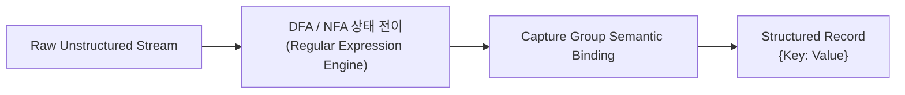
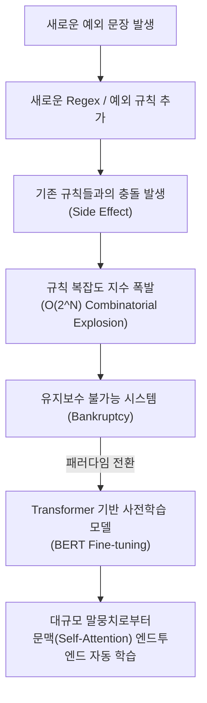

# A4-2 학습용 md

## 목적
비정형 텍스트(Unstructured Text) 속에서 원하는 핵심 데이터(이메일, 전화번호, 금액 등)를 정밀하게 추출하는 정규표현식(Regex)의 원리와 활용법을 숙달하고, 감성 분석(Sentiment Analysis)의 3가지 패러다임(사전 기반, 머신러닝, 딥러닝)을 깊이 있게 이해한다. 특히 규칙 기반 감성 분석에서 부정어·강조어 처리 알고리즘과 엣지 케이스를 다루고, 규칙 기반의 한계가 현대 트랜스포머(BERT) 기반 딥러닝으로 이어지는 필연적 이유를 학습한다.

---

# 🟢 쉬운 설명

## 1. 정보 추출(Information Extraction)이란? 진흙 속에서 황금 캐기
우리가 매일 보는 인터넷 뉴스, 영수증 사진, 고객 상담 카카오톡 대화 등은 정해진 양식 없이 줄글로 길게 늘어서 있습니다. 이를 컴퓨터 과학에서는 **비정형 텍스트(Unstructured Text)**라고 부릅니다.

사람은 긴 계약서나 영수증을 보면 본능적으로 눈을 굴려 "전화번호가 어디 있지?", "총금액이 얼마지?", "계약 날짜가 언제지?"를 찾아 형광펜을 칠합니다.
이처럼 **수많은 글자 더미 속에서 우리가 진짜 필요로 하는 핵심 정보(알맹이)만 쏙쏙 뽑아내어 엑셀 표처럼 깔끔하게 정리하는 기술**을 **정보 추출(Information Extraction)**이라고 합니다.

---

## 2. 정규표현식(Regex): 글자들의 비밀 암호 설계도
컴퓨터에게 "여기서 이메일 주소 좀 찾아줘"라고 한국말로 부탁하면 컴퓨터는 알아듣지 못합니다. 이메일이 도대체 어떻게 생겼는지 컴퓨터가 이해할 수 있는 '생김새의 규칙'을 알려주어야 합니다.
이 '글자의 모양 규칙'을 적어두는 특수 암호 언어를 **정규표현식(Regular Expression, 줄여서 Regex)**이라고 부릅니다.

### 1) 메타문자: 글자의 종류를 가리키는 마법 기호
- `\d` : 숫자(Digit) 하나를 의미합니다. (0부터 9까지 중 하나)
- `\w` : 글자(Word) 하나를 의미합니다. (알파벳, 숫자, 밑줄 `_`)
- `\s` : 공백(Space) 하나를 의미합니다. (스페이스바, 탭, 엔터)
- `.` : 아무 글자나 딱 한 글자를 의미합니다. (마침표, 문자, 숫자 가리지 않음)
- 대문자로 쓰면 반대의 뜻이 됩니다!
  - `\D` : 숫자가 **아닌** 글자
  - `\W` : 영문/숫자가 **아닌** 특수기호
  - `\S` : 공백이 **아닌** 글자
- `^` : 문장의 맨 처음 시작!
- `$` : 문장의 맨 끝!

### 2) 수량자: "몇 번이나 반복될까?"
- `*` : 0번 이상 반복 (있어도 되고 없어도 됨)
- `+` : 최소 1번 이상 무조건 반복 (적어도 하나는 있어야 함)
- `?` : 0번 또는 1번 (있거나 없거나, 선택사항)
- `{3,5}` : 3번에서 5번 사이로 반복
- **욕심쟁이(Greedy) vs 얌전이(Lazy):**
  - 기본적으로 정규식은 욕심쟁이라서 최대한 길게 먹으려고 합니다.
  - 뒤에 `?`를 붙여주면(`+?`, `*?`) 욕심을 버리고 가장 짧게 매칭되는 순간 멈추는 얌전이가 됩니다.

### 3) 그룹 묶기: 알맹이만 쏙 빼오기
괄호 `( )`를 치면 그 부분만 별도로 '캡처'해서 꺼내올 수 있습니다.
- 예를 들어 전화번호 `010-1234-5678` 전체를 찾으면서, 가운데 번호 `1234`만 쏙 빼내고 싶을 때 괄호를 칩니다: `010-(\d{4})-5678`.

### 4) 전후방 탐색: "앞뒤를 살피되, 그 글자는 가져오지 마라" (레이더 비유)
- `"10,000원"`에서 숫자 `"10,000"`만 가져오고 싶은데 뒤에 `"원"`이 붙어있는지 확인하고 싶을 때 사용합니다.
- 마치 레이더를 돌려 "뒤에 '원'이 있는 곳을 조준해라! 하지만 결과물에 '원' 글자는 담지 마라!" 하고 명령하는 고난도 기술입니다.

---

## 3. 실생활 5대 필수 패턴 쉽게 이해하기
우리가 실무에서 가장 많이 마주치는 5가지 텍스트는 다음과 같습니다.

1. **이메일 주소:** `아이디@도메인.com`
   - 영어와 숫자로 된 아이디 뒤에 반드시 골뱅이(`@`)가 오고, 점(`.`) 뒤에 영문 확장자가 옵니다.
2. **전화번호:** `010-1234-5678`
   - 때로는 하이픈 없이 `01012345678`로 쓰거나, 집 전화번호 `02-123-4567`처럼 길이가 다를 수 있어 유연하게 설계해야 합니다.
3. **날짜:** `2026-10-15`, `2026.10.15`, `2026/10/15`
   - 연도 4자리, 월 2자리, 일 2자리 사이의 구분 기호(`-`, `.`, `/`)가 제각각인 점을 고려해야 합니다.
4. **금액:** `￦50,000`, `$1,200.50`, `30000원`
   - 통화 기호(`₩`, `$`)와 3자리마다 찍히는 콤마(`,`)를 놓치지 않아야 합니다.
5. **인터넷 주소(URL):** `https://www.example.com/item?id=10`
   - `http` 또는 `https`로 시작하고 도메인과 복잡한 슬래시(`/`) 주소를 모두 포함할 수 있어야 합니다.

---

## 4. 파이썬 `re` 모듈의 4총사
파이썬에는 정규표현식을 다루는 `re`라는 내장 라이브러리가 있습니다. 대표적인 함수 4가지만 기억하면 됩니다.

1. `re.match()`: **"첫 글자부터 당장 맞아떨어져야 해!"** (문장 맨 앞이 틀리면 바로 포기)
2. `re.search()`: **"문장 어디에 숨어있든 첫 번째 녀석만 찾아와!"** (글 전체를 훑다가 처음 발견된 것 1개 반환)
3. `re.findall()`: **"조건에 맞는 건 모조리 리스트에 쓸어 담아와!"** (가장 자주 쓰임)
4. `re.finditer()`: **"다 찾되, 어디서 찾았는지 위치(좌표)까지 포함해서 하나씩 건네줘!"** (대용량 문서 처리 시 메모리 절약)

---

## 5. 감성 분석이란? 글 속의 기분(좋음/나쁨) 맞히기
쇼핑몰에 달린 수만 개의 상품 리뷰를 직원이 일일이 읽고 "이 손님은 만족했나? 불만인가?"를 분류하기는 불가능합니다.
컴퓨터가 글을 읽고 **글쓴이의 태도, 감정, 호불호(긍정/부정/중립)를 자동으로 판별하는 기술**을 **감성 분석(Sentiment Analysis)** 또는 오피니언 마이닝(Opinion Mining)이라고 합니다.

감성 분석을 하는 데는 크게 세 가지 길이 있습니다.
1. **사전 기반(Lexicon):** 좋은 말/나쁜 말 사전을 만들어두고 점수를 더하고 빼기 (초창기)
2. **머신러닝 기반(ML):** "이런 단어 조합이 나오면 대개 불만이더라"를 통계 모델이 학습 (중기)
3. **딥러닝 기반(DL):** 문맥과 뉘앙스를 통째로 이해하는 거대 인공신경망 사용 (현대)

---

## 6. 사전(Lexicon) 기반 감성 분석: 감정 계산기
사전 기반 방법은 아주 단순하고 직관적입니다.
연구자가 미리 '감정 단어장'을 만들어 둡니다.
- `"맛있다"`: +2점
- `"친절하다"`: +1.5점
- `"더럽다"`: -2점
- `"느리다"`: -1점

어떤 리뷰가 들어오면 문장을 단어로 쪼갠 뒤 단어장을 뒤져 점수를 합산합니다.
- `"음식이 맛있다(+2), 하지만 서빙이 느리다(-1)"` $\to$ 총점: $+1$점 (긍정!)
초등학생도 이해할 수 있을 만큼 규칙이 투명하고 설명하기 쉽다는 엄청난 장점이 있습니다.

---

## 7. "안"과 "못"의 마법 (부정어 처리)
그런데 사전만 가지고 계산하면 엉뚱한 참사가 일어납니다.
- `"이 집 음식 진짜 맛있다"` $\to$ 맛있다(+2) = **긍정**
- `"이 집 음식 절대 안 맛있다"` $\to$ 맛있다(+2)가 발견되었으니 **긍정??** (틀림!)

사람의 말에는 뒤의 의미를 180도 뒤집어버리는 **부정어(not, 안, 못, 전혀)**가 존재합니다.
따라서 감정 계산기는 `"안"`, `"못"` 같은 부정어를 발견하면, 바로 뒤에 나오는 단어의 점수 부호를 반대로 뒤집어주어야 합니다 (`+2` $\to$ `-2`).

---

## 8. "너무", "진짜"의 힘 (강조어 처리)
단순히 좋다는 말과 엄청나게 좋다는 말은 무게가 다릅니다.
- `"좋아요"`: +1점
- `"진짜 너무 엄청 대박 좋아요"`: +1점만 주기엔 너무 아쉽습니다!

`"매우"`, `"너무"`, `"진짜"`, `"극도로"` 같은 **강조 부사(Intensifier)**가 붙으면, 뒤따라오는 감정 점수에 1.5배나 2배를 곱해 점수를 뻥튀기해 주는 보정 로직이 필요합니다.

---

## 9. 감성 분석 평가: 맞혔나 틀렸나 성적표 매기기
리뷰 100개를 분석했을 때 AI가 얼마나 일을 잘했는지 평가합니다.
- **정확도 (Accuracy):** 100개 중 몇 개를 맞혔는가? (단, 100개 중 90개가 긍정 리뷰라면 그냥 전부 '긍정'이라고만 찍어도 정확도가 90%가 나오는 착시 현상이 발생합니다.)
- **F1 점수 (F1-score):** 긍정 리뷰도 잘 잡고, 드물게 섞여 있는 부정 리뷰도 놓치지 않고 골고루 잘 맞혔는지를 엄격하게 평가하는 종합 점수입니다.

---

## 10. 규칙 기반의 한계: 왜 사람이 만든 규칙은 무너질까?
사전과 규칙으로 감성을 분석하는 방식은 금세 한계에 부딪힙니다.
1. **반어법 (비꼬기):**
   - `"와~ 산 지 하루 만에 액정이 깨졌네. 서비스 센터는 전화도 안 받고 참~ 대~단한 회사 납셨다!"`
   - 규칙 엔진은 '대단한'을 보고 "칭찬이다! 긍정!"이라고 오판합니다.
2. **신조어와 유행어:**
   - `"이 집 돈까스 완전 혜자다"`, `"가성비 쌉가능"`, `"디자인 미쳤다"`
   - 사전에 등록되지 않은 단어들이 매달 쏟아져 나옵니다.
3. **상황에 따라 뜻이 바뀌는 문맥:**
   - `"배터리가 빨리 닳는다"` $\to$ 나쁨(부정)
   - `"배터리가 빨리 충전된다"` $\to$ 좋음(긍정)
   - '빨리'라는 단어 자체는 죄가 없고 뒤에 무엇이 오느냐에 따라 천국과 지옥이 갈립니다.

---

## 11. 딥러닝과 BERT의 등장: 글 전체의 공기를 읽다
사람이 손으로 수만 개의 예외 규칙을 적다 보면 규칙끼리 서로 충돌하여 시스템이 엉망이 됩니다(유지보수의 악몽).
결국 현대 AI는 규칙을 버리고 **BERT와 같은 거대 딥러닝 인공신경망**으로 넘어갔습니다.
BERT는 수억 개의 문장을 미리 읽어보며 단어 사이의 미묘한 문맥, 반어법의 공기, 신조어의 뉘앙스를 스스로 깨우쳤기 때문에, 복잡한 예외 처리 코드를 짜지 않고도 사람처럼 자연스럽게 리뷰의 감정을 알아맞힐 수 있게 되었습니다.

---

# 🔵 어려운 설명

## 1. 정보 추출(Information Extraction, IE)의 이론적 체계

정보 추출은 자연어 텍스트와 같은 비구조화된(Unstructured) 입력 스트림에서 사전에 정의된 온톨로지(Ontology)나 스키마(Schema)에 부합하는 구조화된 릴레이션(Relation), 엔티티(Entity), 슬롯(Slot)을 추출하는 작업입니다.

형식 언어 이론(Formal Language Theory)의 촘스키 위계(Chomsky Hierarchy) 관점에서, 정규표현식은 **3형 문법(Type-3 Regular Grammar)**에 속하며, 이는 메모리가 없는 **결정론적/비결정론적 유한 오토마타(DFA / NFA)**에 의해 $O(n)$ 선형 시간 복잡도로 인식(Recognition) 가능한 언어 집합을 정의합니다.



---

## 2. 정규표현식(Regex) 고급 문법 정밀 해설

### 1) 단축 문자 클래스 및 경계 메타문자
- `\d`: `[0-9]`와 동치 (ASCII 기준).
- `\w`: `[a-zA-Z0-9_]`와 동치.
- `\s`: `[\t\n\r\f\v ]` (공백 문자 집합).
- `\b` (Word Boundary): 단어 문자(`\w`)와 비단어 문자(`\W`) 사이의 0-너비(Zero-width) 경계를 일치시킴.
  - 예: `\bcat\b`는 `"cat"`은 매칭하지만 `"concatenate"`나 `"category"`의 내부 부분 문자열은 매칭하지 않음.

### 2) 수량자(Quantifier)의 3대 동작 메커니즘
1. **Greedy (탐욕적, `*`, `+`, `{m,n}`):** 가능한 최대 길이의 문자열을 소비한 후, 뒤따르는 패턴이 실패하면 한 글자씩 역추적(Backtracking)합니다.
2. **Lazy / Reluctant (비탐욕적, `*?`, `+?`, `{m,n}?`):** 가능한 최소 길이만을 소비하며, 뒤따르는 패턴이 매칭을 요구할 때마다 하나씩 추가 소비합니다.
3. **Possessive (독점적, `*+`, `++`):** 최대 길이를 소비한 후 절대 역추적(Backtrack)을 허용하지 않습니다. 정규식 엔진의 재귀적 백트래킹으로 인한 서비스 거부 공격(ReDoS: Regular Expression Denial of Service) 방지에 필수적입니다.

### 3) 캡처링, 비캡처링 및 명명된 그룹
- **Capturing Group `(pattern)`:** 매칭된 서브스트링을 백참조(Backreference, `\1`) 및 인덱스 번호로 메모리에 저장.
- **Non-Capturing Group `(?:pattern)`:** 연산자 우선순위 지정 또는 수량자 적용을 위해 묶되, 캡처 버퍼에 저장하지 않아 메모리와 런타임 오버헤드를 절감.
- **Named Group `(?P<name>pattern)`:** 캡처된 결과에 의미론적 키를 부여하여 딕셔너리(`match.groupdict()`)로 추출 가능.

### 4) 전후방 탐색(Lookaround Assertions: Zero-Width Match)
문자열을 실제로 소비(Consume)하지 않고 포인터 위치에서의 전방/후방 조건 성립 여부만 검증하는 0-너비 단언(Assertion)입니다.

| 문법 | 명칭 | 평가 방향 및 논리 |
| :--- | :--- | :--- |
| `(?=pattern)` | Positive Lookahead | 현재 위치 기준 **오른쪽**에 pattern이 **존재해야 함** |
| `(?!pattern)` | Negative Lookahead | 현재 위치 기준 **오른쪽**에 pattern이 **없어야 함** |
| `(?<=pattern)` | Positive Lookbehind | 현재 위치 기준 **왼쪽**에 pattern이 **존재해야 함** (고정 길이 권장) |
| `(?<!pattern)` | Negative Lookbehind | 현재 위치 기준 **왼쪽**에 pattern이 **없어야 함** (고정 길이 권장) |

---

## 3. 산업용 5대 패턴 설계 가이드 및 엣지 케이스 처리

실무 데이터 추출 파이프라인에서 수많은 예외와 노이즈를 완벽히 통제하기 위한 정밀 정규식 패턴 및 엣지 케이스 분석입니다.

```python
import re

PATTERNS = {
    # 1. Email (RFC 5322 간소화 및 도메인 TLD 제약)
    "email": re.compile(
        r'\b[A-Za-z0-9._%+-]+@[A-Za-z0-9.-]+\.[A-Za-z]{2,}\b'
    ),
    
    # 2. Korean Phone Number (010, 지역번호, 하이픈 유무 완벽 커버)
    "phone": re.compile(
        r'\b(?:01[016789]|02|0[3-6][1-5])-?(?:\d{3,4})-?\d{4}\b'
    ),
    
    # 3. Date (ISO 8601 및 다형적 구분자: YYYY-MM-DD, YYYY.MM.DD, YYYY/MM/DD)
    "date": re.compile(
        r'\b(?P<year>\d{4})[-/.](?P<month>0[1-9]|1[0-2])[-/.](?P<day>0[1-9]|[12]\d|3[01])\b'
    ),
    
    # 4. Currency (통화 기호, 천 단위 콤마, 소수점 결합)
    "currency": re.compile(
        r'(?:[\$₩€]|USD|KRW)\s*[-+]?\d{1,3}(?:,\d{3})*(?:\.\d{1,2})?|\b\d{1,3}(?:,\d{3})*(?:\.\d{1,2})?\s*(?:원|달러|엔)\b'
    ),
    
    # 5. URL (RFC 3986 준수: Scheme, Host, Port, Path, Query, Fragment)
    "url": re.compile(
        r'https?:\/\/(?:www\.)?[-a-zA-Z0-9@:%._\+~#=]{1,256}\.[a-zA-Z0-9()]{1,6}\b(?:[-a-zA-Z0-9()@:%_\+.~#?&//=]*)'
    )
}
```

### 엣지 케이스(Edge Cases) 대응 전략
1. **이메일(Email):**
   - 연속된 점(`user..name@domain.com`) 또는 골뱅이 직전 점(`user.@domain.com`)은 RFC 위반이나 현실 데이터에 빈번히 존재.
   - 서브도메인이 다단계인 경우(`abc@mail.alumni.ox.ac.uk`) 지원을 위해 `[A-Za-z0-9.-]+` 처리.
2. **전화번호(Phone):**
   - 하이픈 없이 붙여 쓴 11자리(`01012345678`)와 서울 지역번호 2자리(`02-123-4567`, 9~10자리)의 가변 길이 충돌 방지를 위해 `\d{3,4}` 분기 처리.
3. **날짜(Date):**
   - 2월 31일, 4월 31일 등 달력상 불가능한 일자는 순수 정규식만으로 완벽 검증 시 식이 지나치게 비대해지므로, 1차 정규식 파싱 후 `datetime.strptime()` 후처리 유효성 검사를 병행하는 것이 업계 표준 아키텍처임.
4. **금액(Currency):**
   - 소수점이 없는 원화(`₩50,000원`)와 소수점이 존재하는 달러(`$1,234.56`) 간의 포맷 불일치 대응.
   - Lookahead를 이용한 콤마 삽입/검증: `(?<=\d)(?=(\d{3})+(?!\d))`.
5. **URL:**
   - 괄호가 포함된 위키피디아 주소(`https://en.wikipedia.org/wiki/Kernel_(operating_system)`) 매칭 시 끝 괄호 누락 방지.

---

## 4. Python `re` 모듈 함수 간 메커니즘 비교

```python
import re

text = "문의: support@codyssey.com 및 sales@codyssey.com으로 연락 바랍니다."
pattern = r'[A-Za-z0-9._%+-]+@[A-Za-z0-9.-]+\.[A-Za-z]{2,}'

# 1. match(): 문자열의 인덱스 0부터 즉시 일치하는지 확인
m = re.match(pattern, text)
print(m)  # None (텍스트의 시작이 '문의:'이므로 즉시 실패)

# 2. search(): 문자열 전체를 스캔하여 '최초로' 매칭되는 단 1개의 Match 객체 반환
s = re.search(pattern, text)
print(s.group())  # support@codyssey.com
print(s.span())   # (4, 25)

# 3. findall(): 매칭되는 모든 부분 문자열을 파이썬 list of str 형태로 즉시 반환
fa = re.findall(pattern, text)
print(fa)  # ['support@codyssey.com', 'sales@codyssey.com']

# 4. finditer(): 매칭되는 모든 결과를 순회 가능한 Match 객체 제너레이터(Iterator)로 반환
# 대용량 텍스트(GB 단위) 처리 시 메모리 점유율을 O(1)로 유지하며 span 좌표 추적 가능
for fi in re.finditer(pattern, text):
    print(f"발견: {fi.group()} | 위치: {fi.start()} ~ {fi.end()}")
```

---

## 5. 감성 분석(Sentiment Analysis)의 세 가지 접근법 비교

| 비교 항목 | 1. 사전 기반 (Lexicon-based) | 2. 머신러닝 기반 (ML-based) | 3. 딥러닝 기반 (DL / Transformers) |
| :--- | :--- | :--- | :--- |
| **핵심 알고리즘** | VADER, SentiWordNet, 감성 점수 룩업 | TF-IDF + Linear SVM, Logistic Reg | BERT, RoBERTa, Electra (Self-Attention) |
| **학습 데이터 필요성**| 불필요 (사전 정의된 어휘집 사용) | 중간 (수천~수만 건의 라벨링 데이터) | 대규모 사전학습 + 미세조정(Fine-tuning) |
| **문맥 이해 능력** | 전무 (국소 윈도우 규칙에만 의존) | 낮음 (n-gram 수준의 통계적 상관관계) | 탁월 (전체 시퀀스 양방향 어텐션) |
| **추론 속도 / 자원** | 극도로 빠름, CPU만으로 충분 | 매우 빠름, 가벼운 모델 가중치 | 연산량 높음, GPU 인퍼런스 가속 권장 |
| **해석 가능성 (XAI)** | 100% 투명 (규칙 및 단어 점수 추적) | 가중치 벡터($\mathbf{w}$) 계수로 파악 가능 | 복잡 (어텐션 맵 기반 간접 해석) |

---

## 6. 사전 기반 감성 분석 엔진 설계 및 구현

사전 기반 분석기는 어휘 사전 $L = \{(w, s) \mid w \in \Sigma^*, s \in [-1.0, 1.0]\}$을 기반으로 토큰 시퀀스의 가중 평균 또는 누적 점수를 산출합니다.

```python
class AdvancedLexiconAnalyzer:
    def __init__(self, lexicon_dict, negations, intensifiers):
        self.lexicon = lexicon_dict          # {'좋다': 1.0, '나쁘다': -1.0, ...}
        self.negations = set(negations)      # {'안', '못', '전혀', '별로'}
        self.intensifiers = intensifiers    # {'너무': 1.5, '매우': 2.0, '진짜': 1.8}
        self.window_size = 3                 # 부정어의 영향 범위

    def analyze_sentence(self, tokens):
        total_score = 0.0
        n_scored_tokens = 0
        i = 0
        
        while i < len(tokens):
            token = tokens[i]
            if token in self.lexicon:
                base_score = self.lexicon[token]
                
                # 1. 선행 윈도우(k=3) 내 강조어(Intensifier) 탐색 및 가중치 누적
                multiplier = 1.0
                start_window = max(0, i - self.window_size)
                for prev_idx in range(start_window, i):
                    prev_token = tokens[prev_idx]
                    if prev_token in self.intensifiers:
                        multiplier *= self.intensifiers[prev_token]
                
                # 2. 선행 윈도우 내 부정어(Negation) 탐색 및 부호 반전
                is_negated = False
                for prev_idx in range(start_window, i):
                    if tokens[prev_idx] in self.negations:
                        is_negated = True
                        break
                
                final_token_score = base_score * multiplier
                if is_negated:
                    # 부호 반전 및 감쇠 계수(0.8) 적용
                    final_token_score = -final_token_score * 0.8
                
                total_score += final_token_score
                n_scored_tokens += 1
            i += 1

        # 정규화된 최종 감성 점수 산출 (-1.0 ~ +1.0)
        if n_scored_tokens == 0:
            return 0.0, "NEUTRAL"
        
        normalized_score = total_score / n_scored_tokens
        # 클리핑
        normalized_score = max(-1.0, min(1.0, normalized_score))
        
        if normalized_score >= 0.15:
            sentiment = "POSITIVE"
        elif normalized_score <= -0.15:
            sentiment = "NEGATIVE"
        else:
            sentiment = "NEUTRAL"
            
        return normalized_score, sentiment
```

---

## 7. 부정어 처리 (Negation Handling)의 정밀 알고리즘

부정어 처리는 국소 구문 트리(Syntactic Parse Tree) 상에서 부정소(Negative Particle)가 수식하는 영역인 **부정 스코프(Negation Scope)**를 결정하는 문제입니다.

### 수학적 모델
토큰 시퀀스 $T = (t_1, t_2, \dots, t_n)$에서 감성어 $t_i$의 본래 점수를 $S(t_i)$라 할 때, 윈도우 $k$ 내에 부정어 $t_j \in N_{neg}$ ($i - k \le j < i$)가 존재할 경우 보정된 점수 $S'(t_i)$는 다음과 같이 정의됩니다.
$$S'(t_i) = -\alpha \cdot S(t_i)$$
여기서 $\alpha$는 **감쇠 계수(Damping Factor, 통상 $0.7 \le \alpha \le 0.9$)**입니다. 
- 이유: `"좋지 않다"`는 단순한 `"나쁘다"`와 동일한 강도의 부정이 아니라, 완곡한 부정(Litotes)의 성격을 띠기 때문에 원점수를 100% 온전히 반전시키기보다는 약간의 감쇄를 가하는 것이 언어학적으로 더 정확합니다.

---

## 8. 강조어 및 완화어(Intensifier & Downtoner) 가중치 전략

수식어(Modifier)는 감성어의 극성(Polarity) 자체를 뒤집지는 않지만 진폭(Intensity)을 변조합니다.

1. **증폭어 (Amplifier / Intensifier):** 가중치 $\beta > 1.0$ (예: `"매우"` $\to 2.0$, `"극도로"` $\to 2.5$)
2. **완화어 (Downtoner / De-amplifier):** 가중치 $0 < \gamma < 1.0$ (예: `"약간"` $\to 0.6$, `"조금"` $\to 0.7$)

수식어들이 연속으로 출현할 경우, 선형 합산 모델($\sum$)이 아닌 곱누적 모델($\prod$)을 적용하되 무한 발산(Exploding)을 방지하기 위해 상한선(Clipping Threshold $M_{max} = 3.0$)을 설정합니다.
$$M(t_i) = \min \left( M_{max}, \prod_{j \in \text{Window}} w(t_j) \right)$$
$$S_{\text{final}}(t_i) = M(t_i) \cdot S'(t_i)$$

---

## 9. 감성 분석 평가 지표 (Evaluation Metrics)

감성 분석은 일반적으로 긍정(Pos), 부정(Neg), 중립(Neu)의 3-클래스 분류 문제로 모델링됩니다.

$$ \text{Confusion Matrix} = \begin{bmatrix} C_{pos, pos} & C_{pos, neu} & C_{pos, neg} \\ C_{neu, pos} & C_{neu, neu} & C_{neu, neg} \\ C_{neg, pos} & C_{neg, neu} & C_{neg, neg} \end{bmatrix} $$

### 클래스 불균형(Class Imbalance) 환경에서의 F1-Score
일반적으로 고객 리뷰 데이터셋은 긍정 리뷰가 80% 이상을 차지하는 극단적 편향을 보입니다. 이때 단순 정확도(Accuracy)는 성능을 왜곡하므로 반드시 **Macro-F1**을 기준으로 평가해야 합니다.
$$\text{Accuracy} = \frac{\sum_{c} C_{c, c}}{\sum_{i} \sum_{j} C_{i, j}}$$
$$\text{Precision}_c = \frac{C_{c, c}}{\sum_{i} C_{i, c}}, \quad \text{Recall}_c = \frac{C_{c, c}}{\sum_{j} C_{c, j}}$$
$$\text{F1}_c = 2 \cdot \frac{\text{Precision}_c \cdot \text{Recall}_c}{\text{Precision}_c + \text{Recall}_c}$$
$$\text{Macro-F1} = \frac{1}{|C|} \sum_{c \in C} \text{F1}_c$$

---

## 10. 규칙 기반 접근법의 성공 케이스와 구조적 실패 케이스

### 성공 케이스 (Success Case)
- 정형화된 설문조사 단답형 텍스트: `"친절하고 빠르며 배송 상태가 매우 우수함"`
- 어휘의 수식 관계가 단순하고 부정/강조어가 감성어 바로 앞에 인접해 있는 구문 구조.

### 치명적 실패 케이스 (Failure Modes)
1. **반어법 및 냉소 (Sarcasm & Irony):**
   - `"주문한 지 한 달 만에 왔네요. 배송 속도에 아주 감탄했습니다^^"`
   - 긍정 어휘(`'감탄'`)와 부정적 상황(`'한 달 만에'`)의 인지적 불일치는 표층적 어휘 규칙으로 탐지 불가능.
2. **도메인 종속적 극성 반전 (Contextual Polarity Shift):**
   - 스릴러 영화: `"공포스럽고 소름 끼치며 끔찍했다"` $\to$ **극찬(Positive)**
   - 호텔 숙박: `"공포스럽고 소름 끼치며 끔찍했다"` $\to$ **최악(Negative)**
3. **신조어, 은어, 형태 변형(Ad-hoc Spacing & Leetspeak):**
   - `"개존맛"`, `"존좋"`, `"노답"`, `"안 좋 은 덱"` (의도적 띄어쓰기로 정규식 및 사전 우회)
4. **양면 복합 리뷰 (Aspect-based Mixed Sentiments):**
   - `"카메라는 환상적인데 배터리는 쓰레기다"`
   - 하나의 문장 내에 상반된 극성이 공존할 때 전체 문장 단일 스칼라 점수화의 왜곡 발생.

---

## 11. 규칙 기반의 유지보수 비용 한계와 현대 딥러닝(BERT Fine-tuning) 도입 배경



### 1) 규칙 기반의 조합 폭발(Combinatorial Explosion)
규칙 기반 시스템은 새로운 엣지 케이스를 해결하기 위해 규칙을 추가할수록 기존 규칙과 충돌하는 사이드 이펙트(Side Effect)가 발생합니다. 규칙 $n$개가 존재할 때 가능한 상호작용의 수는 $O(2^n)$으로 증가하여 소프트웨어 엔지니어링 관점에서 유지보수 불가능 상태(Technical Debt)에 도달합니다.

### 2) BERT (Bidirectional Encoder Representations from Transformers)의 해결 메커니즘
- **양방향 셀프 어텐션 (Bidirectional Self-Attention):**
  $$\text{Attention}(Q, K, V) = \text{softmax}\left(\frac{QK^T}{\sqrt{d_k}}\right)V$$
  문장 내 특정 단어의 의미를 고정된 스코어로 보지 않고, 시퀀스 내의 **모든 다른 단어들과의 상호 상관관계 가중치**를 계산하여 동적으로 결정합니다.
- `"배터리가 빨리 닳는다"`에서 `'빨리'`는 `'닳다(부정)'`와 강하게 어텐션되고, `"배터리가 빨리 충전된다"`에서 `'빨리'`는 `'충전(긍정)'`과 어텐션되어 문맥에 따른 극성이 완벽히 구분됩니다.
- 사전학습된 언어 모델(Pre-trained Language Model)의 `[CLS]` 토큰 출력단에 선형 분류 레이어(Classification Head)를 부착하고 라벨 데이터로 미세조정(Fine-tuning)함으로써, 복잡한 정규식이나 수작업 사전 없이도 90% 이상의 높은 감성 분류 정확도를 달성하게 되었습니다.
